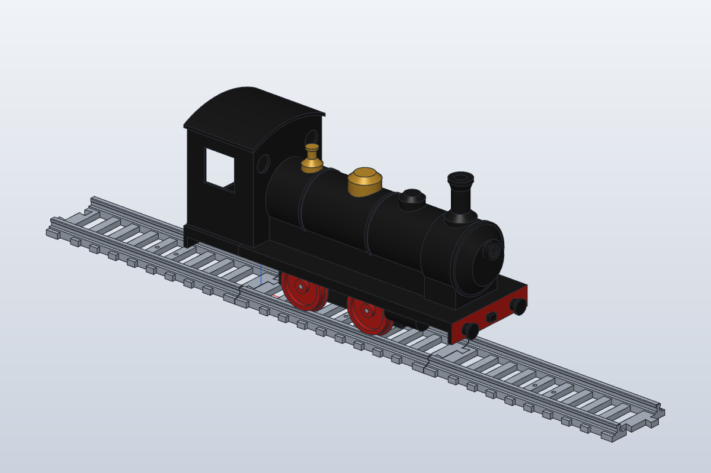

# Faz 1 CAD — Ray, tekerlek ve test şasisi

Tüm ölçüler `params.json` içinde. `build.py` bunları SolidCraft kullanıcı parametrelerine çevirir,
her parça için komut scripti (`scripts/*.json`) yazar ve `solidcraft-cli run` ile derler.

```bash
python3 cad/build.py                 # hepsi
python3 cad/build.py ray_duz_200     # tek parça
```

| Klasör | İçerik |
|---|---|
| `designs/*.sc` | Parametrik SolidCraft tasarımları (Parametreler tablosundan değiştirilebilir) |
| `out/step`, `out/stl`, `out/3mf` | Dışa aktarımlar (STL/3MF baskı yönünde) |
| `out/*.measure.json` | Hacim, kutu ölçüsü, kütle (SolidCraft ölçümü) |
| `renders/` | Görseller |

## Parçalar

| Dosya | Ölçü (mm) | Not |
|---|---|---|
| `ray_duz_200` | 214 × 66 × 13 | 200 mm modül + 7 mm kırlangıç dili, 2× M3 montaj deliği |
| `ray_viraj_r750_15` | 209 × 90 × 13 | R750, 15° (24 adet = tam daire) |
| `tekerlek_test_d42` | Ø47 × 7.5 | Arka yüz yatağa |
| `pul_aks_4mm` | Ø5.5 × 1 | Tekerlek–rulman arası (veya hazır M4 pul) |
| `sasi_test_040` | 130 × 38 × 22 | 0-4-0 iç çerçeve, 70 mm dingil mesafesi, 4× 684ZZ (`plate_len` = 130; eski çıktı 110 idi, Faz 3'te yeniden derlendi) |
| `tolerans_kuponu` | 82 × 34 × 6 | Aks delikleri Ø3.8–4.2, rulman yuvaları Ø9.0–9.3 |
| `montaj_kontrol` | — | Yalnız kontrol amaçlı (baskı yok) |

Hepsi X2D'nin 256 × 256 × 260 mm hacmine sığıyor.

## Önerilen ray/tekerlek standardı (varsayım, test edilecek)

| | Değer |
|---|---|
| Ray açıklığı G | 45.0 |
| Ray başı | 5.0 geniş, 8.0 yüksek (travers üstünden), 0.6 pah |
| Tekerlek arka yüzleri arası B | 40.0 |
| Flanş | 2.5 yükseklik, 1.8 kalınlık |
| Yuvarlanma yüzeyi | Ø42, 1:20 konik |
| Yanal boşluk | G − B − 2·flanş = 1.4 |
| Rijit dingil (70 mm) R750'de sehim | 70²/(8·750) ≈ 0.8 (< 1.4: sığıyor) |
| Ek yeri boşluğu | 0.5 (her uçta 0.25), ray uçlarında 0.4 pah |
| Kırlangıç | 6 → 9 genişlik, 7 boy, 0.2 boşluk; her uçta bir dil + bir yuva (modül iki yönlü takılır) |

İleride makas yapılacağı için çekme payı (flange-way) en az 2.5 mm olmalı: G − B = 5 mm bunu karşılıyor.

## PETG baskı ayarları (başlangıç)

| Parça | Ayar |
|---|---|
| Genel | 0.4 nozul, 0.2 katman, 250 °C nozul / 70–80 °C tabla, Textured PEI, fan %30–50 |
| Raylar | Traversler yatakta, destek yok, 3 duvar, %20 gyroid; ray başının düzgünlüğü için üst yüzde ironing kapalı |
| Tekerlek | Arka yüz yatakta, 4 duvar, %40 dolgu, delik için "precise wall" açık; flanş üst kenarı 45°'den dik değil, destek gerekmez |
| Şasi | Yan levha yatakta (STL bu yönde), 4 duvar, %30 dolgu; rulman yuvaları dikey eksenli olur (daha yuvarlak) |
| Kupon | Önce bunu bas; deliklerin hangisi uyuyorsa `wheel_bore` ve `bearing_clear` değerlerini güncelle, sonra yeniden derle |

## Test prosedürü

1. **Kupon:** 4 mm çelik aks hangi delikte sıkı (tekerlek) ve hangi delikte serbest dönüyor; 684ZZ hangi yuvaya elle bastırılıyor. Değerleri `params.json`'a yaz.
2. **Ray ölçümü:** Kumpasla ray açıklığını 3 noktada ölç (hedef 45.0 ± 0.2). Çarpılma için düz zeminde kontrol et.
3. **Bağlantı:** 3 düz modülü birleştir; ek yerinde basamak (< 0.2 mm) ve boşluk kontrolü. 10 kez sök-tak.
4. **Tekerlek:** Ø, B ölçüsü (40.0 ± 0.2) ve flanş kalınlığı. Aksın tekerlekte kaymadığını kontrol et (gerekirse CA yapıştırıcı veya set vida).
5. **Yuvarlanma:** Şasiyi düz rayda elle it; takılma, zıplama, flanşın ray başına binmesi olmamalı. 2–3° eğimde kendiliğinden yuvarlanıyor mu bak.
6. **Viraj:** 2+ viraj modülüyle S ve düz–viraj geçişlerinde aynı test. Flanşın ray iç kenarına sürtme sesi ve sıkışma kontrolü.
7. **Dış mekân (PETG):** Bir modülü güneşte 1 hafta bırak, çarpılma ve açıklık değişimini ölç.

## Bilinen eksikler / doğrulanmamışlar

- Fiziksel baskı yapılmadı; tüm toleranslar tahmini.
- Viraj modülünde geçiş eğrisi (easement) ve dever yok.
- Rulmanlar şasi levhasında; tekerlek aksa sabit, aks rulmanda dönüyor. Motor yuvası ve dişli henüz yok (Faz 2).
- Montaj kontrolü yalnız düz rayda yapıldı; virajda tekerlek–ray çakışma kontrolü yapılmadı (hesapla doğrulandı).
- Uç traversler kırlangıç bölgesinde 5 mm kalınlıkta; bahçede ağır yük altında dil kırılabilir, testten sonra kalınlaştırılabilir.

---

# Faz 2 — Motorlu şasi (sonsuz vida)

Seçilen düzen: **boyuna 370 motor + tek ağızlı sonsuz vida, 30:1**, ön aksta.
Kurşun açısı küçük (tan λ ≈ 0.1) ve PETG–PETG sürtünmesi tahminen ~0.2 olduğundan sonsuz vidanın geri döndürülmeye direnç göstermesi *beklenir*; ancak bu **garanti değildir**: gerçek sürtünme yük, yağlama, aşınma, sıcaklık ve titreşimle değişir, kendinden kilitleme kurşun açısı/sürtünme oranından kesin olarak çıkarılamaz. Baskı ve eğim testi **yapılmadı**. Bağımsız bir park freni veya park güvenliği **yok**; tren eğimde ya da şarj istasyonunda kendiliğinden kaymayacak diye varsayılmamalı (takoz, düz istasyon zemini veya ayrı fren gerekebilir).

| Dosya | Açıklama |
|---|---|
| `sasi_motorlu_040` | Test şasisi + motor perdesi (2× M2.5), yan duvarlar, arka yatak. 130 × 38 × 44 |
| `sonsuz_vida_m1` | m1, Ø10 bölüm, 16.5 boy, Ø2.2 mil deliği. **İki gövde** (göbek + helis): SolidCraft 0.18.3'te birleştirme >10 dk sürdüğü için ayrı bırakıldı; Bambu Studio baskıda birleştirir |
| `karsi_disli_m1_z30` | m1 z30 düz involüt dişli (Ø32), Ø3.9 aks deliği + M3 set vidası |
| `montaj_motorlu` | Ray + şasi + tekerlekler + motor yer tutucu, kontrol amaçlı |

Hesaplar (varsayım):
- Eksen mesafesi (10+30)/2 + 0.15 = 20.15 mm; diş tepesi–karşı kök boşluğu 0.4 mm.
- 370 motor ~5000–7000 rpm (2S: 7.4 V nominal, tam dolu 8.4 V — motorun 8.4 V'ta sürekli çalışması doğrulanmadı) → aks 167–233 rpm → 0.37–0.51 m/s (2.6 kg tren için ~0.3 W, motor için çok rahat). Hız PWM ile düşürülecek.
- Kurşun açısı 5.7°: karşı dişli düz basıldı, dişli genişliği boyunca ~0.24 mm sapma geri boşlukla karşılanıyor. Aşınma görülürse helisel dişliye geçilmeli.

Doğrulanan (SolidCraft `inspect.clearance`): tekerlek–ray 0.05, tekerlek–şasi 1.0, sonsuz vida göbeği–şasi 1.5, karşı dişli–şasi 2.5, karşı dişli–motor 2.5 mm, çakışma yok.
Beklenen temaslar: motor mili vida deliğinde (sıkı geçme), karşı dişli aksta (sıkı geçme), motor şasi yatağında.

**Doğrulanmamış:** helis dişi ile karşı dişlinin kavraması (helisli boşluk kontrolü 15 dk'da bitmedi). Hesapla 0.4 mm radyal boşluk var; baskıdan sonra elle çevirerek kontrol et.

Ek parçalar (satın alınacak): RF-370 / RS-370 motor (Ø24.4 × 30.5, Ø2.3 mil — **ölçüleri kumpasla doğrula**, `params.json` → `drive`), 2× M2.5×6 vida, 1× M3×4 set vidası.

---

# Faz 3 — Lokomotif gövdesi, tender ve yolcu vagonu

Yeni parametre grupları `params.json` → `body`, `tender`, `coach`. Tüm gövde parçaları aracın kendi
çerçevesinde çizilir (x hat yönü, +x ön; y aks ekseni; z = 0 aks merkezi, ray üstü z = −21.0).
Lokomotifte bu çerçeve motorlu şasinin çerçevesiyle aynıdır.



## Yerleşim (varsayımlar)

| | Değer (aks ekseninden; ray üstü için +21.0) |
|---|---|
| Lokomotif | 300 uzun (tampon başları), 95 geniş (platform), ray üstünden baca tepesi **155.0** |
| Platform (footplate) | alt yüzü z = 26, 3 mm kalın; tekerlek flanş tepesi 23.5 → **2.5 mm boşluk**, sıçrama siperine gerek yok |
| Kazan | Ø56, eksen z = 66, x = −71.7…95; duman kutusu Ø62, x = 95…128; 45° konik kapak + Ø14 fener |
| Kazan içi | 2.4 mm et, altı ve arkası açık; 46 mm genişlikte etek platforma oturur. Motor, ESP32, sürücü kazan içinde |
| Kabin | x = −142…−72, 86 geniş, yan duvar 117, çatı yayı tepesi 127 (R 97.45); 2 ön yuvarlak pencere, yan pencereler, arka açıklık 60×55 |
| Şasiye bağlantı | ön platformdaki iki Ø10 dikme şasi traverslerine (x = ±60, y = 0) oturur; üstten **M3×25** (dikme 14 + platform 3 + traversa ~8) `DeckHoleF/B`'ye vidalanır |
| Tamponlar / kanca | 2× tampon y = ±30, z = 18 (raydan 39); ön kirişte kanca bloğu, arkada çeki çatalı |
| Çeki kolu | 44 mm pim aralığı, araç kirişleri arası 28 mm. Pim = alttan M3×25 vida (çatal alt çenesinde geçiş, üstte kılavuz) |
| Tender | 144 kiriş arası + 2×8 tampon = **160**, 90 geniş, depo üstü raydan 113; motorsuz 0-4-0 şasi (70 mm dingil) |
| Vagon | 220 (tampon başları) × 90, kasa 196 uzun, çatı tepesi raydan 131 (+çatı 2.4); 2 boji, pivot ±50, boji dingili 48 |

**Pil varsayımı:** 2S Li-ion (2× 18650 yan yana) ≈ 70 × 37 × 20 mm + BMS. Tender deposunun iç hacmi
≈ 135 × 81 × 58 mm; kömür kapağı açıklığı 64 × 72 mm, pil bu açıklıktan dikine sığar. Kablo depo ön
yüzündeki Ø8 delikten lokomotif kabin ön duvarındaki 40 × 50 geçişe gider (kazanın arkasında görünmez).

## Parçalar (Faz 3)

| Dosya | Ölçü (mm, tasarım yönü) | Baskı yönü (STL/3MF) | Not |
|---|---|---|---|
| `lok_platform_on` | 234 × 95 × 23.5 | Ters (üst yüz yatakta) | Ön tampon kirişi + 2 tampon + kanca, silindirler, 2 şasi dikmesi, motor açıklığı 96 × 40 |
| `lok_platform_arka` | 66 × 95 × 19 | Ters | Kabin tabanı, arka kiriş + tamponlar, çeki çatalı |
| `lok_kazan` | 219 × 64 × 69 | **Dik, arka ucu yatakta** (219 yükseklik < 260) | Kazan + duman kutusu + kapak + fener (Ø5 LED kanalı Ø6, Ø10×2 lens yuvası); destek gerekmez (kapak 45°) |
| `lok_kabin` | 70 × 86 × 98 | Alt yüzü yatakta | Çatısız; pencereler köprü/yuvarlak, destek önerilir yalnız yan pencere üst kenarına (32 mm köprü) |
| `lok_kabin_cati` | 74 × 90 × 17 | Ucu yatakta | 2 yerleştirme dili duvarların içine iner |
| `lok_baca` | Ø27 × 41 | Tepesi yatakta | Altında Ø11 pim; kazandaki deliğe yapıştırılır |
| `lok_buhar_domu` / `lok_kum_domu` / `lok_emniyet_ventili` | Ø28×17 / Ø22×14 / Ø18×23 | Tepesi yatakta | Pirinç renk (dom, ventil) önerilir |
| `ceki_kolu` | 54 × 10 × 5.5 | Düz | Her bağlantıya 1 |
| `tender_sasi` | 104 × 38 × 22 | Yan levha yatakta | Motorsuz; travers delikleri M3 geçiş |
| `tender_platform` | 160 × 90 × 19 | Ters | İki uçta tampon + çeki çatalı |
| `tender_depo` | 140 × 86 × 63 | Ters | İçi boş, kömür/pil açıklığı |
| `tender_kapak` | 68 × 76 × 13.5 | Alt yüzü yatakta | Kömür yığını + yerleştirme tapası |
| `vagon_boji` | 64 × 38 × 22 | Yan levha yatakta | Vagon başına 2 |
| `vagon_platform` | 220 × 90 × 18 | Ters | Boji pivot dikmeleri (M3 kılavuz) |
| `vagon_govde` | 196 × 90 × 81 | Alt yüzü yatakta | 6×2 pencere, iki alında kapı açıklığı |
| `vagon_cati` | 200 × 94 × 17 | Ucu yatakta (200 yükseklik) | |
| `lokomotif_montaj`, `tender_montaj`, `vagon_montaj` | — | Baskı yok | Kontrol montajları (renkli) |

Tüm STL'ler baskı yönünde, yatağa (z = 0) oturtulmuş ve XY'de ortalanmış olarak dışa aktarılır
(`build.py` → `bed_drop`). En büyük parça `lok_platform_on` 234 × 95 × 23.5 — X2D'ye sığıyor.

Malzeme listesi ve tüm parçaların makinece okunur dökümü: **`parts.json`** (`python3 cad/parts_manifest.py`
ile `out/*.measure.json`'dan yeniden üretilir).

## Baskı ayarları (PETG, başlangıç)

| Parça | Ayar |
|---|---|
| Kabuklar (kazan, kabin, depo, kasa) | 0.2 katman, 3 duvar (2.4 mm et = 5–6 çizgi, dolgu yok gibi), %15 dolgu; kazan dik basılırken brim 5 mm |
| Platformlar | Ters basılır (üst yüz yatakta, düz ve pürüzsüz); 4 duvar, %25 gyroid. Tamponlar ve kanca alt yüzde köprü yapar, destek yok |
| Dom, baca, ventil | Tepesi yatakta; 0.12 katman daha güzel görünür. Taban semeri havada kalır → "support on build plate only" yeterli |
| Çatılar | Ucu yatakta, brim 5 mm (ince ve uzun) |
| Renk | Siyah PETG gövde; kırmızı tekerlek; tampon kirişi kırmızıya boyanabilir (montajda kırmızı gösterildi); dom/ventil pirinç renkli PETG |

## Montaj sırası

1. Motorlu şasiyi (Faz 2) tekerlek, aks ve motorla birleştir.
2. `lok_platform_on` ile `lok_platform_arka`'yı alt flanşlarından **2× M3×10 cıvata + somun** ile birleştir (x = −84).
3. Platformu şasinin üstüne oturt; dikmeler traverslere gelir. Üstten **2× M3×25** ile `DeckHoleF/B`'ye vidala
   (kazan takılmadan önce). Gövdeyi sökmek için önce kazan (alttan 4 vida; x = 70 / −68 şasi levhalarının dışında, alttan erişilir) çıkarılır.
4. Fener: 5 mm LED'i kazanın içinden kanala it, önüne Ø10 lens. ESP32, sürücü, buck dönüştürücü kazan içine (çift taraflı bant). Gerilim seçimleri açık kararlardır (aşağıda).
5. Kazanı platforma oturt, alttan **4× M3×8** ile (x = 70 ve −68, y = ±18.1) iç kaburgalara vidala.
6. Kabini oturt, alttan **4× M3×8** (x = −77.4 ve −134, y = ±37.6). Çatıyı tak (sıkı geçme; gerekirse bir damla yapıştırıcı).
7. Baca, domlar ve ventili pimlerinden kazandaki deliklere yapıştır (kum domu yapıştırılmazsa ön şasi vidasına erişim kalır).
8. Tender: şasi → platform (alttan 2× M3×20, x = ±45), depo (4× M3×8), kapak (tapa ile oturur). Pil kapağın altına.
9. Çeki kolu: lokomotif arka çatalı ile tender ön çatalı arasına koy, alttan M3×25 pimleri tak.
10. Vagon: bojiler platform pivotlarına alttan **M3×20** (boji serbest dönecek kadar gevşek; kontra somun veya bir damla vida sabitleyici), kasa 4× M3×8, çatı.

## Doğrulananlar (SolidCraft 0.18.3, gerçekten ölçülen)

- Her parça tek gövde, `shells = 1`, kapalı (sonsuz vida hariç, Faz 2'deki gibi 2 gövde). Kutu ölçüleri yukarıdaki tabloda; hepsi 256 × 256 × 260'a sığıyor (`parts.json` → `fits_x2d`).
- Lokomotif gövdesi montajda: **300.0 × 95.0**, ray üstünden en yüksek nokta **155.0** (baca), gövdenin en alt noktası raydan 26.5 (tampon kirişi).
- `inspect.clearance` (`lokomotif_montaj`): gövde parçaları (9) ↔ şasi, motor, motor mili, karşı dişli, sonsuz vida, 4 tekerlek, 2 aks, 3 ray: **çakışma 0**, kontrol edilemeyen çift 0. Gövde parçalarının birbirleriyle çakışması: 0.
  En yakın mesafeler: platform–şasi 0 (vida dikmeleri traverslere oturuyor, amaçlı temas), kazan–şasi 1.6, platform–tekerlek 2.5, kazan–tekerlek 5.5, platform–sonsuz vida 3.45, platform–karşı dişli 7.4, platform–motor 8.6, kazan–motor 10.2, kabin–tekerlek 23.5.
- `inspect.clearance` (`tender_montaj`, tüm gövdeler): çakışma 0; şasi–tekerlek 1.0, tekerlek–ray 0.05, depo/kapak/platform yalnız temas (0).
- `inspect.clearance` (`vagon_montaj`, tüm gövdeler): çakışma 0; boji–tekerlek 1.0, tekerlek–ray 0.05. (İlk denemede boji dingil mesafesi 44 < flanş Ø47 olduğundan tekerlekler çakışıyordu → 48'e çıkarıldı.)
- Görseller kontrol edildi: `renders/lokomotif_iso.png`, `lokomotif_yan.png`, `lokomotif_on.png`, `tender_iso.png`, `vagon_iso.png`, `vagon_yan.png`.

## Doğrulanmayanlar / bilinen eksikler

- Fiziksel baskı yok; vida dikmesi, yerleştirme pimi (Ø11 / delik Ø11.3) ve çatı dili boşlukları tahmini.
- **Virajda kontrol yapılmadı:** tampon/çeki kolu payı ve bojili vagonun R750'de dönüşü yalnız hesapla (28 mm kiriş arası, 44 mm çeki kolu). Boji dönüşünde boji tekerleğinin vagon platformu eteğine yaklaşması kontrol edilmedi.
- Çeki kolunun çatal yarığındaki yanal dönüşü (yarık 22 geniş, kol 10) ölçülmedi.
- Sallanan biyel/kol (connecting rod) yok — sonraki faz. Silindirler yalnız görsel.
- Emniyet ventili x = −46'da: −50…−60 aralığında SolidCraft kazan kabuğuna delik açamadı ("boolean Cut: no result"), bu yüzden kaydırıldı.
- Kömür kapağı (`tender_kapak`) STL'i yalnız 44 üçgen (yalnız düz yüzler, normal); kömür yığını sade bir kesik piramit.
- Gövde içi ESP32/sürücü/buck yerleşimi modellenmedi; kazan iç kesiti ≈ 51 mm çap, motor açıklığının önünde ~60 mm, arkasında ~20 mm boş uzunluk var (ölçülmedi, tahmin).
- Tamponlar sabit (yaysız).

## Satın alma listesine eklenenler (lokomotif başına; tam liste `parts.json` → `hardware`)

| Kalem | Adet |
|---|---|
| M3×25 vida (gövde → şasi) | 2 |
| M3×8 vida (kazan 4, kabin 4) | 8 |
| M3×10 cıvata + somun (platform birleşimi) | 2 |
| M3×25 vida (çeki pimi) | 1 loko + 2 tender + 2 vagon |
| M3×20 vida (tender platform→şasi, vagon boji pivotu) | 2 tender + 2 vagon |
| 5 mm sıcak beyaz LED + 220 Ω | 1 |
| Ø10 × 2 lens (isteğe bağlı) | 1 |
| 2S Li-ion 2×18650 paket (~70×37×20) + 2S BMS | 1 (tenderde) |
| ESP32 kartı, DRV8833/TB6612, buck dönüştürücü (çıkış gerilimi açık karar, girişi 8.4 V'a dayanmalı), A3144 hall, açma/kapama anahtarı | 1'er |

---

# Faz 3b — Araçlar arası elektrik hattı: yalnız mekanik hazırlık

Bu bölüm **elektrik tasarımı değildir** ve üretime hazır değildir. Yalnız tender ve yolcu vagonu
gövdelerine kablo geçişi için yer ayrıldı. Gerilim, akım, konnektör tipi ve sigorta seçilmedi.

## Modele eklenenler (params → `wiring`)

| Yer | Ne | Ölçü |
|---|---|---|
| `tender_depo` ön (x = 70) ve arka (x = −70) duvarı | 2-pin kutuplu konnektör yuvası + iç tutucu blok + 45° baskı desteği | Yuva 10.4 × 6.2, 8 derin; üst kenarda 3 × 1.2 kutuplama kanalı; arkada 6 × 3 tel çıkışı (omuz: konnektör içeri itilemez). Eksen y = 0, z = 84 (raydan ≈ 105) |
| `vagon_govde` ön/arka alın duvarı (x = ±98) | Aynı yuva | Aynı. Alın kapısı üst kenarı 88 → **68** alçaltıldı (yuvaya yer) |
| `tender_depo`, `vagon_govde` +y yan duvarı | 3 iç kablo kelepçesi (duvarla kapalı tünel, 45° destekli) | Tünel 4 × 4, z = 42. Tender x = −40/0/40, vagon x = −70/0/70 |
| `vagon_cati` | İç tepe boyunca düz LED şerit yüzeyi + +y dilinde kablo çentiği | Yüzey 12 geniş (8 mm şerit VARSAYIM), çentik 5 geniş |
| `tender_depo` ön duvar | **Ana güç** (pil → lokomotif) Ø8 deliği korundu | Aksesuar hattından ayrı |

**Konnektör ölçüleri VARSAYIMDIR** (JST-XH 2P sınıfı bir kablo-kablo/panel konnektörü düşünüldü).
Konnektör seçilince `params.json → wiring.conn_*` güncellenip `python3 cad/build.py tender_depo vagon_govde`
ile yeniden derlenmeli.

**Lokomotife konnektör eklenmedi.** Lokomotif–tender arasında bugün yalnız ana güç kablosu geçer.
Lokomotiften öne aksesuar hattı gerekirse ayrı karar.

## Mekanik ilkeler

- **Çekme kuvvetini kablo taşımaz:** araçları çeki kolu (M3 pimler) bağlar. Ara kablo serbest bir
  döngü olarak durur; araç içindeki tel konnektörün arkasından kablo bağıyla kelepçe tünellerine
  bağlanır. Böylece kablo çekilirse yük kelepçeye biner, konnektör lehimine binmez.
- **Kablo kuplörden ve tekerleklerden uzak:** konnektörler araç ekseninde (y = 0), çeki kolunun
  (z = 15.5–22.5) ve tamponların (üstü z = 25) çok üstünde, z = 84'te.
- **Aksesuar hattı, ana güç ve şarj kontakları ayrı yollardır.** Şarj kontakları bu fazda modellenmedi.

## R750 kablo/pin hesabı (`coupling_calc.py` → `coupling_calc.json`)

Düzlemsel bir ön hesaptır. Aracın dönme merkezi (0-4-0'da dingil ortası, bojili vagonda iki pivot
ortası) ray ekseninde, araç oraya teğet kabul edildi; araçları 44 mm'lik rijit çeki kolu bağlar.
S-viraj geçişi, dikey hareket, ray toleransı ve kablonun sertliği hesapta **yok**.

| Çift | Pim–pim (düz/R750) | Tampon başı iç boşluk (düz → R750) | Konnektör yüzleri (düz → R750) | 70 mm kabloda en az pay | En kötü sarkma (V varsayımı) |
|---|---|---|---|---|---|
| loko–tender* | 44 / 44 | 12.0 → 11.2 | 30.0 → 30.9 | 39.1 | 21.0 → döngü tabanı tampon üstünden 38, platform üstünden 34 |
| tender–vagon | 44 / 44 | 12.0 → **5.7** | 34.0 → 34.1 | 35.9 | 20.8 → 38.2 / 34.2 |
| vagon–vagon | 44 / 44 | 12.0 → **3.2** | 36.0 → 36.1 | 33.9 | 20.6 → 38.4 / 34.4 |

\* Lokomotifte konnektör yok; satır, hesap için kabin arka yüzünde varsayılmış bir konnektörle yapıldı.

Yorum (test değil): eksendeki konnektörler arasında virajda mesafe yalnız ~0.1–0.9 mm değişir, bu yüzden
70 mm kablo hesapta gergin kalmaz. Döngü sarkarsa bile en alçak noktası tamponların ~38 mm üstünde kalır.
Hesaplanan tampon başı iç boşluğu vagon–vagon çiftinde R750'de **3.2 mm**'ye düşüyor: dar ama pozitif.
S-virajda bu değer daha da küçülebilir ve **hesaplanmadı**. Bu sonuçlar fiziksel bir viraj testinin yerini tutmaz.

## Açık kararlar (seçilmedi)

| Konu | Durum |
|---|---|
| Aksesuar hattı gerilimi | **Seçilmedi.** Pil 2S: 7.4 V nominal, 8.4 V tam dolu (tam boşta ~6 V). Doğrudan pil gerilimi mi, regüleli bir gerilim mi verileceği açık; 5 V varsayılan değildir |
| Aksesuar hattı sigortası / akım sınırı | **Seçilmedi** (değer, tür, yer) |
| Konnektör tipi ve akım değeri | **Seçilmedi.** Yuva ölçüleri varsayım; seçilecek konnektörün akım değeri, toplam aydınlatma akımı + pay olmalı |
| Araç başına izin verilen yük, hat boyunca gerilim düşümü, en fazla araç sayısı | **Hesaplanmadı** |
| LED şerit gerilimi ve tipi | **Seçilmedi** (hat gerilimine bağlı) |
| Lokomotif lojik beslemesi (ESP32 buck çıkışı) | Açık; buck girişi en az 8.4 V'a dayanmalı |
| Ana güç kablosu kesiti / konnektörü / sigortası | **Seçilmedi** (motor akımı ölçülmedi) |
| Şarj kontakları | **Modellenmedi**, ayrı faz |
| Kutuplama/ters takma koruması | Yuvada mekanik kanal var; konnektör seçilmeden işe yaradığı **doğrulanmadı** |

## Faz 3b'de doğrulananlar (gerçekten ölçülen)

- `tender_depo` 95 018 mm³ (Faz 3: 90 943), `vagon_govde` 87 473 mm³ (81 276), `vagon_cati` 54 878 mm³ (51 658); kutu ölçüleri değişmedi; her biri tek gövde, `shells = 1`.
- STL'ler baskı yönünde yatağa oturuyor (z min = 0).
- `inspect.clearance`: `tender_montaj` (17 çift) ve `vagon_montaj` (37 çift) **çakışma 0**, kontrol edilemeyen çift 0. Vagon kasası–en yakın tekerlek 12.7 mm.
- Görsel kontrol: `renders/vagon_kablo_ucu.png` (alındaki yuva ve alçaltılmış kapı).

**Doğrulanmayanlar:** baskı yok; konnektörün yuvaya oturması, kutuplama kanalı, tutucunun çekme
dayanımı, kelepçe tüneline kablo bağının geçişi, LED şerit yapışması, R750 ve S-viraj sürüş testi.
Lokomotif montajı yeniden derlendi (inceleme 3MF'i için); lokomotif gövdesinde değişiklik yok.

## İnceleme amaçlı renkli montaj 3MF'leri (BASILMAZ)

`out/3mf/lokomotif_montaj.3mf`, `tender_montaj.3mf`, `vagon_montaj.3mf`: dünya koordinatında, parça
renkleri `basematerials` içinde, **ray hariç** (`build.py → REVIEW_3MF`, `file.export bodies` listesi).
Site 3B görüntüleyicisi içindir; `parts.json`'da basılacak parça listesinde değil, `review_assemblies`
altındadır. Kontrol edildi (zip içi `3D/3dmodel.model`):

| Dosya | Nesne | Ray | Üçgen | Renkler |
|---|---|---|---|---|
| `lokomotif_montaj.3mf` (1.29 MB) | 21 (tasarımdaki 24 gövdeden 3 ray hariç; eksik yok) | yok | 113 522 | gövde #1B1B1B, tekerlek #C0201A, dom/ventil #B8892C, şasi #202020, motor, dişliler |
| `tender_montaj.3mf` (0.37 MB) | 10 | yok | 34 820 | gövde, tekerlek, şasi, aks; tampon kirişleri yüz rengiyle kırmızı |
| `vagon_montaj.3mf` (0.64 MB) | 17 | yok | 58 634 | kasa #2F5A2A, çatı #8A8A8A, platform, bojiler, tekerlekler |

Koordinatlar ray modülüne göredir (lokomotif ve tender x = 100 merkezli, vagon x = 200 merkezli;
ray üstü z = 13).

---

# Faz 4 — 250 vagon ortak şasisi, çeki kolu ve Şarj 250

Kaynak: `docs/standart.md` §1–2 (ölçü, bağlantı) ve §5 (döner şarj kolları).

**Faz 4b (6 Kasım 2026):** İlk denenen T45 otomatik kuplörü (`kuplor_kafa`, `kuplor_kolu`: koni–huni, iki mıknatıs, iki pogo modülü, kilit kulağı) kaldırıldı; bu ölçekte fazla parça, ince duvar ve hassas hizalama istiyordu. Yerine tek parça çeki kolu (`ceki_kolu_250`, `ceki_kolu_tender_250`) ve gövde alın duvarlarında 4 pinli TrenBus yuvası geldi; elektrik elle takılan ara kabloyla geçer.

Parametreler `params.json` → `car`, `coupler`, `car_family` (`sj_*`, `sv_*`). Bütün ölçüler **VARSAYIM**; hiçbir parça basılmadı.

```bash
python3 cad/build.py vagon_platform_250 tampon_250 ceki_kolu_250 ceki_kolu_tender_250 \
  sarj_platform sarj_govde sarj_cati sarj_kol sarj_istasyon sarj250_montaj sasi250_montaj
python3 cad/coupling_calc.py
python3 cad/parts_manifest.py
```

`build.py` artık macOS/Linux'ta da çalışır: `SOLIDCRAFT_CLI` verilmezse `PATH`'teki `solidcraft-cli` kullanılır; Windows yolu (`wslpath`) yalnız `.exe` CLI ile WSL'den çalışırken kullanılır.

## Parçalar

| Dosya | Ölçü (mm) | Not |
|---|---|---|
| `vagon_platform_250` | 250 × 90 × 17 | Ortak 250 platformu (Şarj hariç bütün 250 vagonlar). Boji pivot göbekleri ±75, iki uçta çeki kolu pivot göbeği (Ø9, M3 kılavuz; kiriş yüzünden 38 içeride) ve kiriş altı kol çentiği (±12°), tampon pim delikleri, Ø8 TrenBus geçişleri |
| `tampon_250` | 12 × 12 × 12 | Ayrı basılır (platform 250 tablaya sığsın diye); pim kirişe yapıştırılır, araç başına 4 |
| `ceki_kolu_250` | 126 × 10 × 5.5 | 250–250 çeki kolu: iki göz, M3 delikleri, pim aralığı 116 (kirişler arası 40 + 2 × 38). Vagon başına 1, ön pivotta |
| `ceki_kolu_tender_250` | 96 × 10 × 5.5 | Tender arka çatalı → ilk 250 vagonun ön pivotu, pim aralığı 86; trende 1 |
| `sarj_platform` | 250 × 90 × 17 | Ortak platform + platform altında 2 servo kulak pedi (M2) ve servo/göbek açıklığı |
| `sarj_govde` | 232 × 80 × 47 | Alçak kasa (duvar 70, tepe 76 aks ekseninden; ray üstü ≈ 97). +y yanında 35 (boy) × 10 (derinlik) × 27 (yükseklik) kol cebi: içi kapalı kutu, tavanda göbek için dışa açık U yuvası (göbek yandan kaydırılır), tabanda servo kolu dönüş açıklığı; ışık çubuğu yarığı (Ø4 ışık borusu), iki alın duvarında 4 pinli TrenBus yuvası (12.4 × 6.2 × 8, kutuplama kanalı üstte; tutucu platformdan yükselir), arka uçta alın kapısı |
| `sarj_cati` | 236 × 84 × 14 | Yay çatı + iki yerleştirme dili |
| `sarj_kol` | 8 × 26 × 29 | **Tek parça**: Ø8 dikey göbek + alt (−) ve üst (+) kol (22 mm), uçlarda pabuç tutucu ve 0.8 mm yaprak yay şerit yuvası, kol üstünde tel kanalı, göbek içinde Ø3 tel deliği, altta servo kolu yuvası |
| `sarj_istasyon` | 102 × 98 × 28 | Taban plakası (traverslerle aynı zeminde, 2× M3) + iki direk + üst üste iki taşıyıcı; ray tarafında 6×1 pirinç lama cebi (lama 0.5 dışarı taşar), direklerde lama ucu bükme yarığı, arkada tel kanalı. Lama yüzü ray ekseninden 59.5; lama eksenleri zeminden 72 (−) ve 90 (+) |

İnceleme 3MF'leri (BASILMAZ): `sarj250_montaj` (vagon, kollar açık; tasarımda istasyon tutucusu da var, 3MF'e ray ile birlikte alınmaz), `sasi250_montaj` (ortak alt takım; site gövdesi henüz yapılmamış 250 vagonları bunun üstünde ölçülü taslakla gösterir), `sarj_istasyon_yerinde` (tasarım yönünde tutucu, hat önizlemesi için).

## Şarj kolu mekanizması

- Tek mikro servo (MG90S sınıfı, ölçüler VARSAYIM) platformun altında, kulakları iki pede M2 ile. Mil yukarı bakar; kol göbeği servonun kısa koluna oturur (yuvaya yapıştırılır). Göbeğin üst ucu cep tavanındaki U yuvasında döner.
- Kollar milden 22 mm, uçta yaprak yay şerit 4 mm dışarı kıvrılır. Açık konumda (90°) şerit ucu ray ekseninden 61; istasyon lama yüzü 59.5'te: **1.5 mm yay baskısı**.
- Kapalıyken (servo −90°) kollar −x yönünde cebin içine yatar; kol ve göbek gövde dış yüzünün (y = 40) **içinde** kalır (kol dış kenarı y = 39). Kapalı kol ucu x = −10, cep arka duvarı x = −18: 8 mm pay.
- Kutup: üst kol **+**, alt kol **−**. Kollar ve lamalar eksenden eksene 18 mm aralıklı; lama 6 mm, pabuç tutucusu 6 mm yüksek, aradaki boşluk 12 mm: bir pabuç iki lamaya birden değemez.
- Tel: şerit ucuna lehim → kol üstü kanal → göbek deliği → servo yanından şarj kartına. Dönüş için göbek altında gevşek döngü bırakılır.

## Doğrulananlar (SolidCraft 0.30.1, gerçekten ölçülen)

- Her basılabilir parça tek gövde ve kapalı; `parts.json` → `fits_x2d` hepsi için doğru (en uzunu 250 mm platform).
- `sarj250_montaj` Faz 4b ile yeniden üretildi (çeki kolu + TrenBus yuvaları): açık kol 18 gövde, kapalı kol 5 gövde, ikisi de **0 çakışma**.

## Bağlantı hesabı (`coupling_calc.py`, düzlemsel)

| Çift | Pim aralığı | Tampon başı iç payı düz → R750 | Kol açısı R750 (öndeki / arkadaki araca) |
|---|---|---|---|
| tender – 250 | 86 | 25.3 → 14.0 mm | 6.6° / 11.4° |
| 250 – 250 | 116 | 24.0 → 11.2 mm | 11.0° / 11.0° |

Kiriş altı çentiği ±12°: R750'de yeterli, S-virajda ve ray hatasında pay az. TrenBus yuvaları arası 51–59 mm (düz ve R750), ara kablo 80 mm.

## Doğrulanmayanlar / açık kararlar

- Servo ve yaprak yay ölçüleri seçilmedi; yuvalar varsayım. Servo kolu yuvası tek kollu kısa servo koluna göre.
- Yay baskısının temas direnci, açık havada pirinç oksitlenmesi ve 8.4 V / 1 A için kesit denenmedi.
- Çeki kolu ve pivot göbeği baskıyla denenmedi; M3 vida plastik göbekte zamanla gevşeyebilir (kontra somun veya ısıyla gömme somun düşünülebilir).
- TrenBus konnektörü seçilmedi (JST-XH 4P varsayıldı). Tender deposu da 4 pinli yuvaya çevrildi (Faz 4b); lokomotifte yuva yok, kablo kabin arka açıklığından girer.
- Yolcu, Enerji, Radar, Ses ve Gözlem 250 gövdeleri modellenmedi; parametreleri (`y5_*`, `en_*`, `rd_*`, `ss_*`, `gz_*`) hazır.
- Faz 3'ün 220 mm yolcu vagonu (`vagon_platform`, `vagon_govde`, `vagon_cati`) eski prototip olarak durur; katalog modellerinin adetlerine sayılmaz.

---

# Faz 4c — 250 vagon gövdeleri

Ortak 250 şasinin üstüne beş vagonun gövdesi. Hepsi platforma 4× M3 (alttan, `car_hole_x/y`) ile vidalanır, iki alın duvarında (radarda yalnız arkada) 4 pinli TrenBus yuvası taşır, çatı ayrı basılır (yay kesit, iki yerleştirme dili). Ölçüler `params.json` → `car_family` (`y5_*`, `en_*`, `ss_*`, `gz_*`, `rd_*`).

```bash
python3 cad/build.py yolcu_govde yolcu_cati enerji_govde enerji_cati ses_govde ses_cati \
  gozlem_govde gozlem_cati gozlem_kubbe radar_kabin radar_cati radar_kaide radar_tabla radar_direk radar_anten \
  yolcu250_montaj enerji250_montaj ses250_montaj gozlem250_montaj radar250_montaj
```

| Vagon | Parçalar | Not |
|---|---|---|
| Yolcu 250 | `yolcu_govde`, `yolcu_cati` | 8 pencere (18 × 26, 22,5 aralık), iki yanda kapı izi ve kapı camı, şeffaf pencere bandı oluğu (1 mm band, iç dudak 3,5), iki alın kapısı, 3 iç kelepçe; çatıda LED yüzeyi |
| Enerji 250 | `enerji_govde`, `enerji_cati` | Kapalı yük vagonu; iki yanda 5'er panjur yarığı, 24 × 8 gösterge yarığı, iç pil rafı (köprü) |
| Ses 250 | `ses_govde`, `ses_cati` | İki yanda iki Ø40 hoparlör ızgarası (5 yarık) ve iç oturma halkası, kayar kapı izleri, amfi kartı kızağı |
| Gözlem 250 | `gozlem_govde`, `gozlem_cati`, `gozlem_kubbe` | Kapalı gövde x = −94 … 116, arkası balkon (taban + korkuluk aynı parçada); 5 geniş pencere ve band oluğu; çatıda kubbe açıklığı; kubbe kesik piramit, tepede Ø10 kamera yuvası, altta yerleştirme yakası |
| Radar 250 | `radar_kabin`, `radar_cati`, `radar_kaide`, `radar_tabla`, `radar_direk`, `radar_anten` | Kısa kabin (−116 … −40), açık platformda kaide (N20 motor cebi, sabit göbek), m1 z56 tabla dişlisi + Ø60 disk, direk (çatal + Ø2 eğim pimi), konik çanak |

## Doğrulananlar

- `inspect.interference`: beş montajın her birinde gövde, çatı, ekler, platform, bojiler, çeki kolu ve tamponlar arasında **0 çakışma** (radar ve gözlemde ilk denemede çıkan çatal–çanak ve çatı–kubbe çakışmaları düzeltildi).
- Hepsi tek gövde, kapalı; X2D tablasına sığar (`parts.json` → `fits_x2d`).

## Doğrulanmayanlar

- Enerji pil rafı ve gözlem balkon tırabzanı köprü/çıkıntı: baskı yönü ve destek denenmedi.
- Radar kaidesinin platforma bağlandığı iki vida deliği platformda yok (montajda delinir); N20 motor ve pinyon ölçüleri varsayım.
- Pencere bandı oluğu toleransı (0,2 mm) ve şeffaf bandın çatı diliyle tutulması denenmedi.
